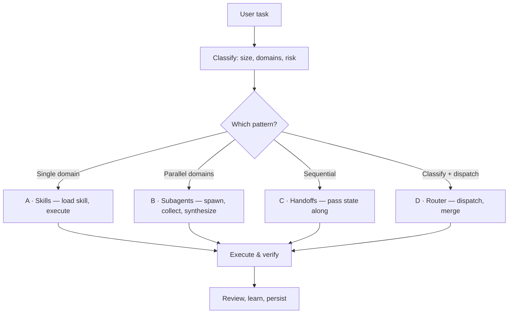

<div align="center">

# ultimate-dev

**The prompt-first agentic skill suite for software agencies and companies.**
**One portable skill that adapts to any model, tool, and department.**

[](https://github.com/usama-bin-sadiq/ultimate-dev-ai-skill/releases)
[](https://github.com/usama-bin-sadiq/ultimate-dev-ai-skill/actions/workflows/release.yml)
[](LICENSE)


[What Is This?](#-what-is-this) ·
[Quick Start](#-quick-start) ·
[How It Works](#-how-it-works) ·
[What's Inside](#-whats-inside) ·
[Supported Tools](#-supported-tools) ·
[Examples](#-examples) ·
[Documentation](#-documentation)

</div>

---

## 🧩 What Is This?

ultimate-dev is a **portable, prompt-first skill suite** for software agencies and companies. It works with any AI model and host, covers software engineering deeply, and adds reusable business, research, audit, finance, operations, and knowledge-work methods without requiring a runtime, Python package, Node.js, or model-provider dependency.

> [!NOTE]
> **No hardcoded technologies. Pure patterns and best practices.** Unknown tech is handled by universal specialists that research it from the web and teach themselves.

📖 **Full docs:** [Architecture](docs/architecture/ARCHITECTURE.md) · [Department coverage](docs/DEPARTMENT-COVERAGE.md) · [Developer Guide](docs/developer/DEVELOPER_GUIDE.md) · [User Guide](docs/user/USER_GUIDE.md)

---

## 🚀 Quick Start

### 1. Install

```bash
# macOS / Linux — interactive: tool-specific/generic, then Global/Project
./scripts/install.sh

# Tool-specific examples
./scripts/install.sh --tool claude-code --global --yes
./scripts/install.sh --tool codex --project . --yes
./scripts/install.sh --tool opencode --global --yes

# Generic examples
./scripts/install.sh --generic --global --yes
./scripts/install.sh --generic --project . --yes

# Windows (PowerShell)
.\scripts\install.ps1                      # interactive
.\scripts\install.ps1 -ToolSpecific -Global -Yes
.\scripts\install.ps1 -Generic -Project . -Yes
```

The installer copies only the contents of the inner `ultimate-dev/` skill folder to the selected `.agents/skills/ultimate-dev/` destination. It does not create memory, `.gitignore`, template, `.cursor`, `.claude`, or symlink files outside that destination. Project memory is created and managed separately by the runtime when needed.

> **Runtime note:** The host-native JEV path has no mandatory Python, Docker, Playwright, package-manager, or external-service dependency. A host supplies its own tools and policy; the reference JSON contract and engine are dependency-free. Legacy Python maintenance utilities remain optional and separate.

📖 **Complete guide:** [User Guide](docs/user/USER_GUIDE.md) for detailed examples and troubleshooting.

### Manual install (no script — works with any compatible host)

```bash
# Copy the contents of the inner skill folder to the host's native skills path.
# The installer/scripts use .agents/skills/ultimate-dev by default.
mkdir -p /path/to/skills/ultimate-dev
cp -R ultimate-dev/. /path/to/skills/ultimate-dev/

# Project memory is separate and is never created or deleted by the installer.
# Create it only when the host/runtime needs durable task memory:
mkdir -p .memory/ultimate-dev/tasks

# Verify the copied payload
test -f /path/to/skills/ultimate-dev/SKILL.md
test -f /path/to/skills/ultimate-dev/VERSION
```

No symlink is required or created by the installer.

> [!TIP]
> Not sure which tools you have? Run `./scripts/detect-tools.sh` to list installed agentic tools, and `./scripts/verify.sh` to check the package integrity.

For the measured payload size, development dependencies, CI-equivalent checks, and uninstall commands, see [`ultimate-dev/INSTALLATION.md`](ultimate-dev/INSTALLATION.md).

### 2. Use

Just use your AI tool normally. The skill activates automatically:

```text
You: "Add user authentication with JWT"
Agent: [tier: small | size: moderate | module: security]
       Implements JWT auth with proper patterns
```

### 3. Done

The agent automatically:

- Classifies your task (atomic / moderate / complex)
- Loads the right module(s) internally
- Applies best practices for your stack
- Adapts depth to your model's context window

---

## 🧠 How It Works

Every task flows through the same operating loop, then fans out to one of four architecture patterns:




### JEV host-native decision boundary

```text
Model / orchestration → JEV decision packet → Runtime → Host-native tools
```

JEV evaluates structured NOUL, CHOICE, and SCORE facts using deterministic
policy. It does not call a model, install tools, run a browser, or own durable
state. Human review and missing capabilities are explicit blocking outcomes.
The contract is language-neutral JSON Schema; the optional reference engine is
`ultimate-dev/runtime/jev/engine.mjs`.

### 📐 How it Adapts to Your Model

The context window is auto-detected at runtime — model names are never hardcoded:

| Model tier | Context | Max modules | Max agents | Max words |
|------------|---------|-------------|------------|-----------|
| **TINY** | ≤8K | 0 | 0 | 500 |
| **SMALL** | ≤32K | 1 | 1 | 2,000 |
| **LARGE** | ≤128K | 3 | 3 | unlimited |
| **HUGE** | >128K | all | unlimited | unlimited |

---

## 📦 What's Inside

Three layers, each with a distinct job — no triple-loading:

| Layer | What it is | When it loads |
|-------|------------|---------------|
| 🧠 **Skills** | Meta-cognitive sub-skills that teach *how to think* (testing, security, architecture, …) | On demand, per pattern |
| 🤖 **Agents** | Domain specialists spawned as stateless subagents | Parallel, multi-domain work |
| ⚙️ **Modules** | Internal pattern libraries per domain | Router classifies, then loads internally |

> [!IMPORTANT]
> Modules are **internal to the skill** — load only `ultimate-dev`. Do **not** call `skill("frontend")` or `skill("backend")`; the router picks modules automatically from task classification.

<details>
<summary>Expand: module departments</summary>

| Department | Modules |
|------------|---------|
| **Engineering** | backend, frontend, architecture, database, security, devops, mobile, testing-qa, documentation |
| **Specialized** | api-patterns, testing-frameworks, real-time, blockchain, ai-ml, data-engineering, cloud, messaging, caching, search, observability, i18n-l10n, performance, accessibility, open-source, legacy-modernization, monorepo |
| **Agency** | project-management, product, design-handoff, client-communication |
| **Business** | marketing, sales, finance, support, paid-media |
| **Research** | research, academic |
| **Domain** | healthcare, game-dev, gis, spatial-computing, specialized |
| **Cross-cutting** | universal-principles, emerging-tech-handler, project-memory-template |

</details>

Live counts (agents, categories, sub-skills, modules) are **auto-synced** into the [skill README](ultimate-dev/README.md) on every release — they never go stale.

### 🌐 Works With ANY Technology

| You use | Skill handles it |
|---------|------------------|
| React or Vue | ✅ Frontend patterns |
| Kafka or RabbitMQ | ✅ Messaging patterns |
| PostgreSQL or MongoDB | ✅ Database patterns |
| AWS or Azure | ✅ Cloud patterns |
| Redis or Memcached | ✅ Caching patterns |
| Anything else | ✅ Universal specialists research it from the web |

---

## 🔧 Supported Tools

Install **once** (global or project scope) — tools auto-discover the skill from `.agents/skills/`. Tool-specific conventions are mapped by adapters:

| Tool | Adapter |
|------|---------|
| Claude Code | [`adapters/claude-code.md`](ultimate-dev/adapters/claude-code.md) |
| Codex CLI | [`adapters/codex.md`](ultimate-dev/adapters/codex.md) |
| Cursor | [`adapters/cursor.md`](ultimate-dev/adapters/cursor.md) |
| OpenCode | [`adapters/opencode.md`](ultimate-dev/adapters/opencode.md) |
| Windsurf | [`adapters/windsurf.md`](ultimate-dev/adapters/windsurf.md) |
| Cline | [`adapters/cline.md`](ultimate-dev/adapters/cline.md) |
| GitHub Copilot | [`adapters/copilot.md`](ultimate-dev/adapters/copilot.md) |
| Aider | [`adapters/aider.md`](ultimate-dev/adapters/aider.md) |
| Any other agentic CLI | [`adapters/generic-cli.md`](ultimate-dev/adapters/generic-cli.md) |

The full compatibility list lives in [`ultimate-dev/skill-manifest.yaml`](ultimate-dev/skill-manifest.yaml) (`compatible_tools`).

> [!NOTE] **Host-specific paths:** The default installer destination is `.agents/skills/ultimate-dev/`. If a host expects a different native skills directory, copy the same inner skill contents there directly. The installer does not create symlinks.

---

## 💡 Examples

### Simple task (atomic)

```text
You: "Write a function to calculate Fibonacci numbers"
Agent: [tier: tiny | work: inline]
       function fibonacci(n) { ... }
```

### Feature task (moderate)

```text
You: "Add user authentication with JWT"
Agent: [tier: small | module: security]
       Loads security module, implements JWT auth
```

### Complex task (decomposed)

```text
You: "Build a full-stack e-commerce platform"
Agent: [tier: large | modules: backend, frontend, database | agents: 3]
       Decomposes into subtasks, spawns agents
```

---

## 📂 Project Structure

```text
ultimate-dev-ai-skill/
├── ultimate-dev/            # The skill package
│   ├── SKILL.md             # Entry point (always loaded)
│   ├── skill-manifest.yaml  # Agent/skill registry (auto-generated)
│   ├── README.md            # Full reference (auto-synced with repo facts)
│   ├── VERSION              # Release version (source of truth)
│   ├── adapters/            # claude-code, codex, cursor, generic-cli
│   ├── agents/              # Domain specialists
│   ├── skills/              # Meta-cognitive sub-skills
│   ├── modules/             # Internal pattern modules
│   └── ...                  # config, prompts, router, workflows, tests, evals…
├── scripts/                 # install.sh, install.ps1, detect-tools.sh, verify.sh
├── .github/workflows/       # Sync & Release CI (README sync + auto-release)
├── ARCHITECTURE.md          # System design
├── docs/adr/                # Architecture decision records
├── CONTRIBUTING.md          # How to contribute
└── README.md                # This file
```

---

## 📚 Documentation

| Document | Purpose |
|----------|---------|
| [README.md](README.md) | You are here — overview & quick start |
| [ultimate-dev/INSTALLATION.md](ultimate-dev/INSTALLATION.md) | Measured install size, dependencies, verification, and uninstall |
| [ultimate-dev/README.md](ultimate-dev/README.md) | Full skill reference — counts auto-synced on release |
| [ultimate-dev/SKILL.md](ultimate-dev/SKILL.md) | Skill entry point (orchestrator) |
| [docs/architecture/ARCHITECTURE.md](docs/architecture/ARCHITECTURE.md) | System design & architecture deep-dive |
| [docs/READINESS.md](docs/READINESS.md) | 10/10 readiness rubric and verification gates |
| [docs/DEPARTMENT-COVERAGE.md](docs/DEPARTMENT-COVERAGE.md) | Department coverage, gaps, and prompt-first optimization plan |
| [docs/PROMPT-SKILL-AUDIT.md](docs/PROMPT-SKILL-AUDIT.md) | Prompt-only quality audit, scorecard, and roadmap |
| [docs/adr/0001-jev-host-native-decision-kernel.md](docs/adr/0001-jev-host-native-decision-kernel.md) | JEV host-native decision boundary |
| [docs/developer/DEVELOPER_GUIDE.md](docs/developer/DEVELOPER_GUIDE.md) | Extending agents, skills, modules, testing |
| [docs/user/USER_GUIDE.md](docs/user/USER_GUIDE.md) | Complete user guide with examples |
| [CONTRIBUTING.md](CONTRIBUTING.md) | How to contribute |
| [Changelog](ultimate-dev/changelog/CHANGELOG.md) | Release notes (source for GitHub Releases) |
| [LICENSE](LICENSE) | MIT license |

---

## 📄 License

MIT — see [LICENSE](LICENSE).

---

**One skill. Every domain. Any model.** 🚀
