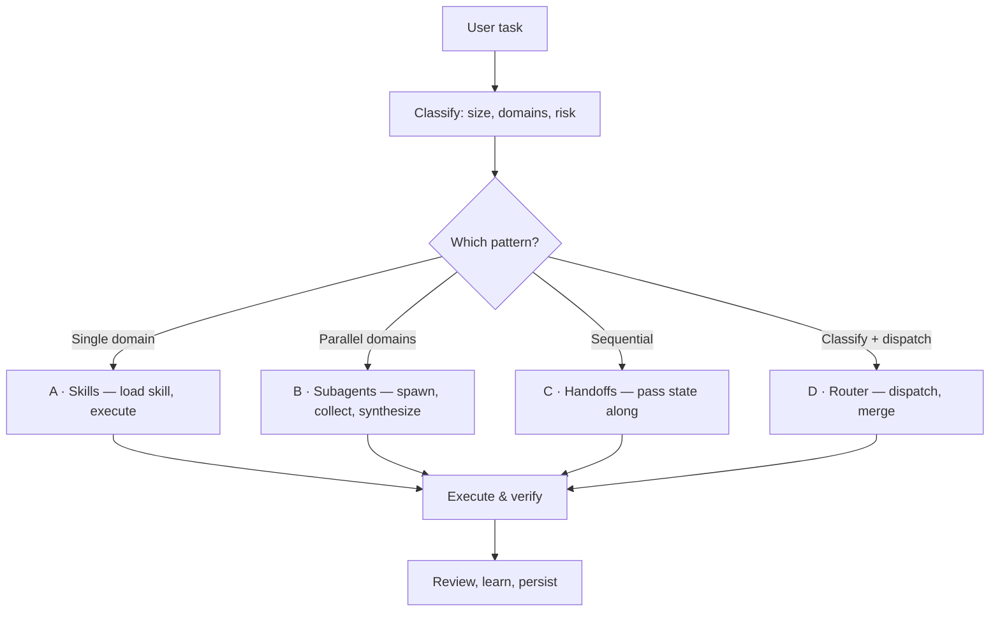

# Ultimate-Dev 3.0.2

> Prompt-first, model-agnostic agentic skill suite for software agencies and companies.

The portable core is Markdown. Prompt-only use has no Python, Node.js, or model-provider dependency. Durable state, JEV, approvals, retention, and recovery are optional runtime extensions for hosts that need them.

[](https://github.com/usama-bin-sadiq/ultimate-dev-ai-skill/releases)
[](https://github.com/usama-bin-sadiq/ultimate-dev-ai-skill/actions/workflows/release.yml)
[](../LICENSE)
[](ultimate-dev/README.md#-how-it-adapts-to-your-model)
[](ultimate-dev/README.md#-supported-tools)

[What Is This?](#-what-is-this) ·
[Quick Start](#-quick-start) ·
[How It Works](#-how-it-works) ·
[What's Inside](#-whats-inside) ·
[Supported Tools](#-supported-tools) ·
[Examples](#-examples) ·
[Validation & Development](#-validation--development) ·
[Documentation](#-documentation)

---

## 🧩 What Is This?

ultimate-dev is a **portable, prompt-first skill suite** for software agencies and companies. It works with any AI model and host, covers software engineering deeply, and adds reusable business, research, audit, finance, operations, and knowledge-work methods without requiring a runtime.

> [!NOTE]
> **No hardcoded technologies. Pure patterns and best practices.** Unknown tech is handled by universal specialists that research it from the web and teach themselves.

---

## 🚀 Quick Start

### 1. Install

```bash
# macOS / Linux — interactive: tool-specific/generic, then Global/Project
./scripts/install.sh

# Tool-specific examples
./scripts/install.sh --tool claude-code --global --yes
./scripts/install.sh --tool codex --project . --yes
./scripts/install.sh --tool opencode --global --yes

# Generic examples
./scripts/install.sh --generic --global --yes
./scripts/install.sh --generic --project . --yes

# Windows (PowerShell)
.\scripts\install.ps1                      # interactive
.\scripts\install.ps1 -ToolSpecific -Global -Yes
.\scripts\install.ps1 -Generic -Project . -Yes
```

The installer copies only the contents of this `ultimate-dev/` skill folder to the selected `.agents/skills/ultimate-dev/` destination. It does not create memory, `.gitignore`, template, `.cursor`, `.claude`, or symlink files outside that destination. Project memory is created and managed separately by the runtime when needed.

> [!TIP]
> Not sure which tools you have? Run `./scripts/detect-tools.sh` to list installed agentic tools, and `./scripts/verify.sh` to check the package integrity.

For exact staged payload size, development dependencies, CI-equivalent checks,
and uninstall instructions, read [`INSTALLATION.md`](INSTALLATION.md).

### 2. Use

Just use your AI tool normally. The skill activates automatically:

```text
You: "Add user authentication with JWT"
Agent: [tier: small | size: moderate | module: security]
       Implements JWT auth with proper patterns
```

### 3. Done

The agent automatically:

- Classifies your task (atomic / moderate / complex)
- Loads the right module(s) internally
- Applies best practices for your stack
- Adapts depth to your model's context window

---

## 🧠 How It Works

Every task flows through the same operating loop, then fans out to one of four architecture patterns:



### 📐 How It Adapts to Your Model

The context window is auto-detected at runtime — model names are never hardcoded:

| Model tier | Context | Max modules | Max agents | Max words |
|------------|---------|-------------|------------|-----------|
| **TINY**   | ≤8K     | 0           | 0          | 500       |
| **SMALL**  | ≤32K    | 1           | 1          | 2,000     |
| **LARGE**  | ≤128K   | 3           | 3          | unlimited |
| **HUGE**   | >128K   | all         | unlimited  | unlimited |

---

## 📦 What's Inside

Three layers, each with a distinct job — no triple-loading:

| Layer | What it is | When it loads |
|-------|------------|---------------|
| 🧠 **Skills** | Meta-cognitive sub-skills that teach *how to think* (testing, security, architecture, …) | On demand, per pattern |
| 🤖 **Agents** | Domain specialists spawned as stateless subagents | Parallel, multi-domain work |
| ⚙️ **Modules** | Internal pattern libraries per domain | Router classifies, then loads internally |

> [!IMPORTANT]
> Modules are **internal to the skill** — load only `ultimate-dev`. Do **not** call `skill("frontend")` or `skill("backend")`; the router picks modules automatically from task classification.

<details>
<summary>Expand: module departments</summary>

| Department | Modules |
|------------|---------|
| **Engineering** | backend, frontend, architecture, database, security, devops, mobile, testing-qa, documentation |
| **Specialized** | api-patterns, testing-frameworks, real-time, blockchain, ai-ml, data-engineering, cloud, messaging, caching, search, observability, i18n-l10n, performance, accessibility, open-source, legacy-modernization, monorepo |
| **Agency** | project-management, product, design-handoff, client-communication |
| **Business** | marketing, sales, finance, support, paid-media |
| **Research** | research, academic |
| **Domain** | healthcare, game-dev, gis, spatial-computing, specialized |
| **Cross-cutting** | universal-principles, emerging-tech-handler, project-memory-template |

</details>

Live counts (agents, categories, sub-skills, modules) are **auto-synced** on every release — they never go stale.

### 🌐 Works With ANY Technology

| You use | Skill handles it |
|---------|------------------|
| React or Vue | ✅ Frontend patterns |
| Kafka or RabbitMQ | ✅ Messaging patterns |
| PostgreSQL or MongoDB | ✅ Database patterns |
| AWS or Azure | ✅ Cloud patterns |
| Redis or Memcached | ✅ Caching patterns |
| Anything else | ✅ Universal specialists research it from the web |

---

### 119 Agents across 36 Categories

<!-- ud:begin agent-tree -->
```
agents/ — 119 agents, 36 categories, 7 root-level
├── academic/            ( 1)  research-methodologist
├── ai-ml/               ( 4)  generic-ai-ml-specialist, ml-engineer, prompt-engineer, rag-architect
├── api-patterns/        ( 1)  api-architect
├── architecture/        ( 2)  microservices-architect, system-architect
├── backend/             (12)  api-designer, csharp-engineer, database-tuner, generic-backend-specialist, generic-shell-specialist, go-engineer, graphql-engineer, java-engineer, nodejs-architect, python-engineer, rust-engineer, tui-specialist
├── blockchain/          ( 1)  smart-contract-developer
├── caching/             ( 1)  cache-engineer
├── cloud/               ( 3)  cloud-architect, cost-optimizer, generic-cloud-specialist
├── data-engineering/    ( 1)  data-pipeline-engineer
├── database/            ( 4)  data-engineer, generic-database-specialist, postgres-specialist, sql-optimizer
├── design-handoff/      ( 3)  design-spec, motion-designer, ux-researcher
├── devops/              ( 7)  generic-devops-specialist, kubernetes-engineer, observability-engineer, pipeline-engineer, reliability-engineer, sre-engineer, terraform-engineer
├── documentation/       ( 2)  devrel-engineer, tech-writer
├── finance/             ( 5)  compliance-officer, financial-analyst, fintech-analyst, pricing-strategist, revenue-operations
├── frontend/            ( 6)  accessibility-engineer, css-architect, generic-frontend-specialist, perf-specialist, react-specialist, vue-specialist
├── game-dev/            ( 3)  game-designer, game-programmer, level-designer
├── gis/                 ( 2)  cartographer, spatial-analyst
├── git/                 ( 1)  git-specialist
├── healthcare/          ( 3)  biotech-researcher, clinical-data-analyst, health-informaticist
├── legacy/              ( 1)  modernizer
├── marketing/           ( 7)  affiliate-marketer, brand-strategist, content-strategist, email-marketing, growth-hacker, seo-specialist, social-media-manager
├── messaging/           ( 1)  event-architect
├── meta/                ( 5)  agent-generator, auto-persona-generator, gap-tracker, skill-maintainer, task-observer
├── mobile/              ( 3)  mobile-android, mobile-flutter, mobile-ios
├── monorepo/            ( 1)  monorepo-architect
├── paid-media/          ( 2)  ads-optimizer, programmatic-buyer
├── performance/         ( 1)  performance-engineer
├── project-management/  ( 3)  product-owner, release-manager, scrum-master
├── real-time/           ( 1)  realtime-engineer
├── sales/               ( 3)  account-manager, outbound-strategist, sales-engineer
├── search/              ( 1)  search-engineer
├── security/            ( 4)  compliance-engineer, incident-responder, security-auditor, threat-modeler
├── spatial-computing/   ( 2)  spatial-ui-designer, xr-developer
├── specialized/         ( 6)  blockchain-engineer, edtech-designer, iot-engineer, legal-tech, quantum-computing, supply-chain
├── support/             ( 3)  customer-success, support-ops, technical-support-engineer
├── testing/             ( 6)  generic-testing-specialist, performance-tester, qa-engineer, quality-engineer, test-architect, test-automator
└── root-level           ( 7)  browser-agent, cli-help, codebase-investigator, generalist, orchestrator, skill-creator, universal-technology-specialist
```
<!-- ud:end agent-tree -->

### 33 Meta-Cognitive Sub-Skills

Each teaches HOW to think about a domain — technology-agnostic:

<!-- ud:begin skills-table -->
| Skill | Purpose |
|-------|---------|
| `self-evolve` | Gates reusable learning behind repeated evidence and review |
| `task-observer` | Capture reusable methodology from task work |
| `research` | Learn anything |
| `coding` | Build anything |
| `testing` | Verify anything |
| `review` | Evaluate anything |
| `architecture` | Design anything |
| `security` | Protect anything |
| `devops` | Deliver anything |
| `debugging` | Fix anything |
| `documentation` | Communicate anything |
| `performance` | Optimize anything |
| `monitoring` | Observe anything |
| `data` | Work with any data |
| `api-design` | Connect anything |
| `migration` | Transition anything |
| `mobile` | Build for any device |
| `ai-ml` | Build intelligent systems |
| `universal-task` | Classify and safely handle unfamiliar or unclassified tasks |
| `accounting-finance` | Structure accounting, controllership, management reporting, budgeting, forecasting,… |
| `audit-controls` | Plan and perform evidence-based control, risk, and assurance reviews for software,… |
| `business-analysis` | Analyze a business problem, operating process, strategy, market, KPI, or decision… |
| `data-analysis-bi` | Perform reproducible data analysis and BI work with clear metric definitions, data… |
| `discovery-requirements` | Clarify product, engineering, research, and business requests into a grounded… |
| `internal-communications` | Create concise internal updates, meeting notes, decision memos, status reports,… |
| `legal-privacy` | Support legal, privacy, contract, policy, records, and data-governance work by… |
| `office-artifacts` | Create, revise, and quality-check common business artifacts including reports,… |
| `people-operations` | Support privacy-conscious people operations workflows including workforce planning,… |
| `planning-execution` | Design and execute a multi-step plan with dependencies, checkpoints, verification… |
| `procurement-vendors` | Structure procurement and vendor-management workflows including intake, requirements,… |
| `project-context` | Build or apply a compact, evidence-based project context recipe before implementation:… |
| `prompt-evaluation` | Evaluate prompt and agent-skill behavior with representative tasks, routing… |
| `strategy-operating-model` | Design and evaluate company strategy, operating models, value chains, capabilities,… |
<!-- ud:end skills-table -->

### Self-Evolution

When repeated evidence shows that a reusable capability is missing:

1. Researches the bounded gap when the host can
2. Executes and verifies a safe task
3. Extracts candidate patterns and provenance
4. Keeps the candidate outside the canonical package
5. Requires independent review, regression cases, and a maintainer decision
6. Uses a memory receipt or candidate handoff; no automatic package write

---

## 💡 Examples

### Simple Task (Tier: SMALL)

```
User: "Fix the login bug"
→ Pattern A: Skills (debugging)
→ Load skills/debugging/SKILL.md
→ Spawn codebase-investigator
→ Fix the bug
→ Verify
```

### Multi-Domain Task (Tier: LARGE)

```
User: "Build a React feature with API and tests"
→ Pattern B: Subagents (multi-domain)
→ Spawn react-specialist (frontend)
→ Spawn api-designer (backend)
→ Spawn test-architect (testing)
→ Parallel execution
→ Synthesize results
```

### Sequential Pipeline (Tier: LARGE)

```
User: "Deploy to production"
→ Pattern C: Handoffs (sequential)
→ Plan (system-architect) → handoff state
→ Implement (auto) → handoff state
→ Test (test-architect) → handoff state
→ Review (code-reviewer) → handoff state
→ Deploy (pipeline-engineer)
```

### Unknown Technology (Tier: SMALL)

```
User: "Use Bun for the backend"
→ No dedicated Bun specialist exists
→ Spawn generic-backend-specialist
→ Web research: Bun documentation
→ Apply universal backend patterns
→ Complete the bounded task and report evidence
→ Propose a reviewed Bun specialist candidate; do not publish automatically
```

---

## 🔧 Supported Tools

Install **once** (global or project scope) — tools auto-discover the skill from `.agents/skills/`. Tool-specific conventions are mapped by adapters:

| Tool | Adapter |
|------|---------|
| Claude Code | [`adapters/claude-code.md`](adapters/claude-code.md) |
| Codex CLI | [`adapters/codex.md`](adapters/codex.md) |
| Cursor | [`adapters/cursor.md`](adapters/cursor.md) |
| OpenCode | [`adapters/opencode.md`](adapters/opencode.md) |
| Windsurf | [`adapters/windsurf.md`](adapters/windsurf.md) |
| Cline | [`adapters/cline.md`](adapters/cline.md) |
| GitHub Copilot | [`adapters/copilot.md`](adapters/copilot.md) |
| Aider | [`adapters/aider.md`](adapters/aider.md) |
| Any other agentic CLI | [`adapters/generic-cli.md`](adapters/generic-cli.md) |

The full compatibility list lives in [`skill-manifest.yaml`](skill-manifest.yaml) (`compatible_tools`).

---

## 🛠 Validation & Development

Install optional development dependencies from the repository root:

```bash
python3 -m pip install -r ultimate-dev/requirements-dev.txt
```

Full setup, measured payload size, host requirements, and uninstall guidance
are in [`INSTALLATION.md`](INSTALLATION.md). Prompt-only users do not need this
step.

```bash
# Host-native JEV conformance (no package manager required)
node --test ultimate-dev/tests/jev/engine.test.mjs

# Optional legacy Python validation checks
python3 scripts/validate.py

# Auto-generate manifest from disk
python3 scripts/generate-manifest.py

# Re-sync README numbers (version, counts, agent tree) with the repo
python3 scripts/sync-docs.py

# Verify README is in sync without rewriting (pre-commit/CI)
python3 scripts/sync-docs.py --check

# Install pre-commit hook (from repo root)
cp ultimate-dev/scripts/pre-commit .git/hooks/pre-commit
chmod +x .git/hooks/pre-commit
```

> **Host-native JEV tests:** The canonical JEV contract and reference engine use JSON Schema and ECMAScript built-ins. They do not require Python, Docker, Playwright, a package manager, or an external service. The existing Python validation utilities remain optional legacy maintenance tooling.

---

## 📂 Structure

```
ultimate-dev/
├── SKILL.md                    ← Orchestrator (478 lines)
├── INSTALLATION.md             ← Size, dependencies, verification, uninstall
├── requirements-dev.txt        ← Optional development dependencies
├── skill-manifest.yaml         ← Auto-generated registry
├── README.md                   ← User documentation (this file)
├── VERSION                     ← Version number (source of truth)
├── AGENT.md / CLAUDE.md        ← Agent entry-point docs for other harnesses
├── adapters/                   ← Harness adapters (claude-code, codex, cursor, generic-cli)
├── agents/                     ← 119 specialized agents
├── skills/                     ← 33 meta-cognitive sub-skills
├── modules/                    ← 46 internal pattern modules
├── config/                     ← Configuration files
│   ├── capability-index.yaml  ← Compact prompt-first routing index
│   └── agent-catalog.yaml     ← Generated concrete-agent catalog
├── contracts/                  ← Portable task and four-channel contracts
│   ├── task-envelope.yaml     ← Deliverable/risk/gap vocabulary
│   └── four-channels.md       ← Intent → Knowledge → Action → Evidence
├── prompts/                    ← Shared prompt components
├── workflows/                  ← Execution pipelines (with agent refs)
├── schemas/                    ← Data contracts
├── rules/                      ← Operational constraints
├── router/                     ← Classification & routing logic
├── templates/                  ← Reusable templates
├── scripts/                    ← Validation, prompt audit, benchmark, context generation, and release helpers
├── tools/                      ← Tool integrations
├── runtime/jev/                ← Host-neutral JEV reference engine
├── runtime/schemas/            ← Runtime and JEV contracts
├── tests/jev/                  ← Dependency-free JEV conformance tests
├── tests/                      ← Validation tests
├── examples/                   ← Usage examples
├── evals/                      ← Evaluation cases
├── reference/                  ← Reference documentation
├── memory/                     ← Memory templates (runtime .memory/ lives at project root)
└── changelog/                  ← Version history
```

---

## 📚 Documentation

| Document | Purpose |
|----------|---------|
| [README.md](../README.md) | GitHub landing — overview & quick start |
| [ultimate-dev/README.md](README.md) | Full skill reference — counts auto-synced on release |
| [Installation and development guide](INSTALLATION.md) | Payload size, dependencies, verification, and uninstall commands |
| [ultimate-dev/SKILL.md](SKILL.md) | Skill entry point (orchestrator) |
| [Department coverage](../docs/DEPARTMENT-COVERAGE.md) | Cross-functional coverage and optimization plan |
| [Prompt-skill audit](../docs/PROMPT-SKILL-AUDIT.md) | Prompt-only quality audit and scorecard |
| [10/10 readiness](../docs/READINESS.md) | Readiness rubric and evidence gates |
| [ARCHITECTURE.md](../ARCHITECTURE.md) | System design for maintainers |
| [ADR-0001](../docs/adr/0001-jev-host-native-decision-kernel.md) | Host-native JEV decision boundary |
| [CONTRIBUTING.md](../CONTRIBUTING.md) | How to contribute |
| [Changelog](changelog/CHANGELOG.md) | Release notes (source for GitHub Releases) |
| [LICENSE](../LICENSE) | MIT license |

---

## 📄 License

MIT — see [LICENSE](../LICENSE).

---

**One skill. Every domain. Any model.** 🚀
